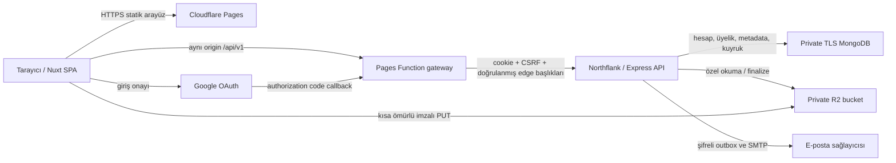
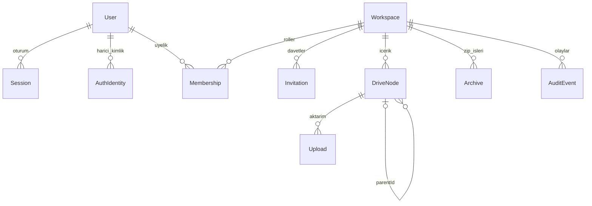
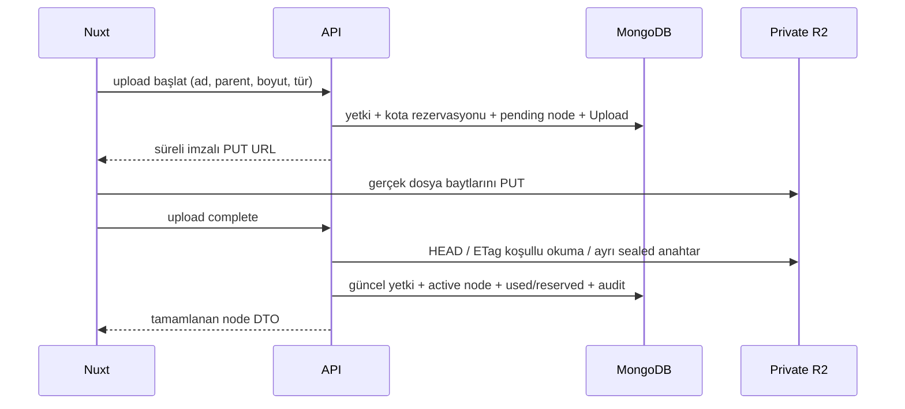

# Ortak Drive — Teknik anlatım ve kod okuma rehberi

Bu rehber, projeyi Yiğit abiye kod üzerinden anlatmak için hazırlanmıştır. Teknolojiyi söylemekle kalmaz; hangi sorunu nerede ve nasıl çözdüğünü gösterir. Açıklamalar mevcut uygulamaya dayanır. Doğrulanmış test ile tasarım tercihi ve ürün sınırı birbirinden ayrılır.

## 1. Projeyi bir dakikada anlat

> Ortak Drive, kullanıcıların birden fazla çalışma alanında dosya ve klasör paylaşabildiği bir uygulama. Kullanıcının rolü her alanda ayrı tutuluyor. Owner alanı ve üyeleri yönetiyor, Editor içerikleri yönetiyor, Viewer okuyup indirebiliyor. Nuxt arayüzü ve Express API'si ayrı depolarda ve ayrı servislerde çalışıyor. MongoDB hesapları, üyelikleri ve dosya bilgilerini; özel R2 bucket dosyanın gerçek baytlarını tutuyor. Canlıda Pages üzerindeki aynı origin API gateway'i oturum cookie'sini Northflank API'sine iletiyor. Yetkiyi yalnız arayüzde değil, sunucuda ve uzun indirmeler sırasında da kontrol ediyoruz.

**Gösterilecek dört bağlantı:** [uygulama](https://ahmet-drive.pages.dev), [API hazırlık kontrolü](https://p01--google-drive-clone-backend--d7y2sxv84npc.code.run/health/ready), [backend](https://github.com/ahmetkocdeveci/google-drive-clone-backend), [frontend](https://github.com/ahmetkocdeveci/google-drive-clone-frontend).

API'nin korumalı yolunu doğrudan açınca `403 EDGE_REQUIRED` görmek beklenen davranıştır. Sağlık yolu ayrı, uygulama isteklerinin yolu `/api/v1` gateway'idir.

## 2. Büyük resim: hangi veri nereye gider?



Üç farklı şeyi ayır:

1. **Arayüz:** düğmeler, sayfalar, kullanıcı etkileşimi. Nuxt/Vue.
2. **Metadata:** bir dosyanın adı, konumu, sahibi, boyutu ve erişim bağlamı. MongoDB.
3. **İçerik:** PDF'nin veya görselin gerçek baytları. R2; geliştirmede özel yerel dizin.

Dosya adı bir nesne anahtarı olarak doğrudan kullanılmaz. R2 anahtarı alan, node ve upload kimliklerinden oluşur. Aynı adlı iki dosya farklı nesneler olabilir. Bucket public değildir.

## 3. Teknoloji tablosu: neyi, nerede, neden kullandık?

| Teknoloji | Projedeki yeri | Neden / sağladığı şey |
| --- | --- | --- |
| Node.js 24.19.0 | API, worker, derleme ve test | Native crypto, stream, test runner; iki repoda aynı çalışma sürümü |
| pnpm 11.25.0 | İki repo | Lockfile ile tekrar kurulabilir bağımlılıklar; frozen CI kurulumu ve sürüme bağlı patch |
| Nuxt 4.6.2 | Frontend | Dosya tabanlı rotalar, layout, middleware, composable ve üretim derlemesi |
| Vue 3.5.44 | Frontend bileşenleri | Reaktif durum ve bileşen bazlı UI; Composition API |
| Vue Router 5.4.0 | Frontend | Alan/klasör rotaları, query ve yönlendirme |
| TypeScript 6.0.3 | Frontend ve DTO sözleşmesi | Derleme öncesi tip kontrolü; mevcut Vue araçlarıyla uyumlu sabit sürüm |
| CSS | Ortak stiller ve component stilleri | Renk/boşluk değişkenleri, responsive düzen; Tailwind veya hazır UI kütüphanesi kullanılmıyor |
| Express 5.3.0 | Backend HTTP katmanı | Router/middleware ve merkezî hata yönetimi; async route hatalarının iletilmesi |
| MongoDB replica set | Kalıcı metadata | Esnek belgeler, indeksler ve çok belgeli transaction |
| Mongoose 9.11.2 | `src/models.mjs` | Şema, model, indeks ve transaction API'si |
| Zod 4.6.7 | Config ve API girdileri | Tür/biçim/sınır doğrulaması; istemci verisi doğrudan sorguya geçirilmez |
| Helmet 8.3.0 | `src/app.mjs` | HTTP güvenlik başlıkları; tek başına bütün güvenliği sağlamaz |
| Native `node:crypto` | Auth, cursor, outbox, yedek | Scrypt, güvenli rastgele token, SHA-256, HMAC, AES-GCM, sabit süreli karşılaştırma |
| jose 6.2.12 | Google callback | Google ID tokenının imza ve claim doğrulaması; uygulama session'ı JWT değildir |
| AWS SDK 3.1152.0 | `src/storage.mjs` | R2'nin S3 uyumlu API'si ve imzalı PUT URL'si |
| Nodemailer 10.1.4 | `src/mailer.mjs` | SMTP; gerçek gönderim kuyruktan yapılır |
| Archiver 8.0.0 | Dosya/klasör arşivleri | Gerçek dosya baytlarından ZIP üretimi |
| PDF.js 6.4.299 | `DrivePdfPreview.vue` | PDF'yi worker ve canvas ile tarayıcıda çizme |
| Node test + Supertest | Backend testleri | Gerçek HTTP route davranışı ve geçici MongoDB test DB'leri |
| Playwright 1.64.1 | Frontend E2E | Gerçek Chromium, UI akışı, upload/download, mobil emülasyon |
| axe-core/playwright 4.14.0 | Erişilebilirlik testleri | Belirli ekranlarda otomatik WCAG A/AA kontrolleri |
| Prettier 3.9.10 | Frontend | Tekrarlanabilir biçim; CI'da format kontrolü |
| Docker | Geliştirme servisleri ve API yayını | Aynı servis ortamı; üretimde root olmayan kullanıcı |
| Mailpit | Yerel/CI SMTP | Gerçek alıcıya mesaj göndermeden e-posta bağlantılarını uçtan uca test |
| GitHub Actions | İki repo | Test/tip/audit/derleme/Docker ve izole tarayıcı otomasyonu |
| Cloudflare Pages / Functions | Frontend yayını / gateway | Statik SPA ve aynı origin API yolu |
| Northflank | API ve MongoDB | Bilgisayar kapalıyken çalışan servis ve private DB ağı |

Paket sürümleri `package.json` ve lockfile'dan kontrol edilir; “en yeni sürüm her zaman güvenlidir” varsayımı yapılmaz. TLS için kaldırılan forge bağımlılığı bölüm 19'da açıklanır.

## 4. Kod mimarisi ve okuma sırası

### Backend

| Dosya | Görevi | Anlatırken vurgula |
| --- | --- | --- |
| [server.mjs](../src/server.mjs) | Config → DB → storage/mailer → app → background work | Uygulamayı bir araya getirir; iş kuralları burada yığılmaz |
| [config.mjs](../src/config.mjs) | Ortam değişkeni ve üretim koşulları | Yanlış origin/TLS/anahtar ile sessiz başlamamak |
| [app.mjs](../src/app.mjs) | Middleware ve router sırası | Edge, Origin, limit, session, CSRF ve merkezî hata sınırı |
| [models.mjs](../src/models.mjs) | Şemalar ve indeksler | Model ilişkisi, unique ve TTL indeksleri |
| [tenant.mjs](../src/tenant.mjs) | Üyelik/izin çözümü ve tenant transaction'ı | Asıl yetki sınırı; aynı Workspace belgesine yazma |
| [auth.mjs](../src/auth.mjs) | Kayıt, giriş, session, doğrulama, reset, Google | Hash, cookie ve provider doğrulaması farklı sorumluluklardır |
| [workspaces.mjs](../src/workspaces.mjs) | Alan, üye, davet, sahiplik | Son Owner, davet adresi ve rol yönetimi |
| [files.mjs](../src/files.mjs) | Node, klasör, upload/finalize, içerik, küçük ZIP | Parent zinciri, yetki, kota ve dosya yaşam döngüsü |
| [storage.mjs](../src/storage.mjs) | Local/S3 adaptörü | Metadata iş kuralını sağlayıcı API'sinden ayırır |
| [stream-access.mjs](../src/stream-access.mjs) | Uzun stream sırasında yeniden yetki | İndirme başladıktan sonra da rol kaldırılabilir |
| [archives.mjs](../src/archives.mjs) | Arşiv API'si ve işlemcisi | Hazırlama, durum, iptal ve süre sonu |
| [worker.mjs](../src/worker.mjs) | Temizlik ve arşiv işleri | HTTP yanıtını uzun fiziksel işlemlere bağlamamak |
| [mailer.mjs](../src/mailer.mjs) | Şifreli outbox ve SMTP | Transaction ile kaydedilen mesajın yeniden denenmesi |
| [background.mjs](../src/background.mjs) | Bağımsız iş/mail döngüleri | Yavaş SMTP'nin dosya temizliğini durdurmaması |
| [pagination.mjs](../src/pagination.mjs) | İmzalı cursor/keyset | Liste sınırı, bağlam ve bayat cursor yönetimi |
| [audit-events.mjs](../src/audit-events.mjs) | Owner işlem geçmişi | Tenant kapsamı ve token içermeyen kayıtlar |
| [operations.mjs](../src/operations.mjs) | Readiness/metrics/ops | Operasyon yetkisi kullanıcı rolünden ayrıdır |
| [backup.mjs](../src/backup.mjs) | Şifreli yedek/restore | Yeni hedef, bütünlük ve bakım aralığı koşulları |

Yapı **modüler Express** uygulamasıdır. Her dosya için ayrı controller/service/repository klasörü açılmış bir mimari değildir; route ve ilgili iş kuralı domain modülünde birlikte bulunabilir. Factory işlevleri `models`, `config`, `storage`, `mailer` alır. Bu bağımlılık aktarımı, gerçek uygulama ile kontrollü test transport'unu aynı kod üzerinden çalıştırmayı sağlar.

### Frontend

| Yol | Görevi |
| --- | --- |
| [`nuxt.config.ts`](https://github.com/ahmetkocdeveci/google-drive-clone-frontend/blob/main/nuxt.config.ts) | `ssr:false` SPA, runtime config, CSS ve PDF kaynakları |
| [`app/pages/`](https://github.com/ahmetkocdeveci/google-drive-clone-frontend/tree/main/app/pages) | Dosya tabanlı ekranlar |
| [`app/layouts/workspace.vue`](https://github.com/ahmetkocdeveci/google-drive-clone-frontend/blob/main/app/layouts/workspace.vue) | Sidebar, alan seçimi, arama ve mobil gezinme |
| [`app/composables/useDrive.ts`](https://github.com/ahmetkocdeveci/google-drive-clone-frontend/blob/main/app/composables/useDrive.ts) | Oturum, aktif alan, liste ve geç gelen cevap korumaları |
| [`app/services/drive-api.ts`](https://github.com/ahmetkocdeveci/google-drive-clone-frontend/blob/main/app/services/drive-api.ts) | UI'nin kullanacağı `DriveApi` arayüzü |
| [`app/services/http-drive-api.ts`](https://github.com/ahmetkocdeveci/google-drive-clone-frontend/blob/main/app/services/http-drive-api.ts) | Fetch, cookie, CSRF, DTO, upload ve archive takibi |
| [`app/services/mock-drive-api.ts`](https://github.com/ahmetkocdeveci/google-drive-clone-frontend/blob/main/app/services/mock-drive-api.ts) | Açıkça seçilen bellek içi demo adaptörü |
| [`app/plugins/drive-api.client.ts`](https://github.com/ahmetkocdeveci/google-drive-clone-frontend/blob/main/app/plugins/drive-api.client.ts) | HTTP veya demo adaptörünü seçip Nuxt'a sağlar |
| [`shared/types.ts`](https://github.com/ahmetkocdeveci/google-drive-clone-frontend/blob/main/shared/types.ts) | DTO ve istek/yanıt tipleri |
| [`shared/permissions.ts`](https://github.com/ahmetkocdeveci/google-drive-clone-frontend/blob/main/shared/permissions.ts) | UI rol/izin matrisi; backend kontrolünün yerine geçmez |
| [`app/middleware/`](https://github.com/ahmetkocdeveci/google-drive-clone-frontend/tree/main/app/middleware) | Giriş/doğrulama/üyelik yönlendirmeleri |
| [`DriveFileBrowser.vue`](https://github.com/ahmetkocdeveci/google-drive-clone-frontend/blob/main/app/components/DriveFileBrowser.vue) | Liste/kart, seçim, menü, drop ve dosya input'ları |
| [`DriveFileDetail.vue`](https://github.com/ahmetkocdeveci/google-drive-clone-frontend/blob/main/app/components/DriveFileDetail.vue) | Ayrıntı, parent konumu ve önizleme penceresi |
| [`DrivePdfPreview.vue`](https://github.com/ahmetkocdeveci/google-drive-clone-frontend/blob/main/app/components/DrivePdfPreview.vue) | Çok sayfalı PDF canvas çizimi |
| [`folder-upload.ts`](https://github.com/ahmetkocdeveci/google-drive-clone-frontend/blob/main/app/services/folder-upload.ts) | Göreli yollardan hiyerarşik aktarım planı |
| [`functions/api/[[path]].js`](https://github.com/ahmetkocdeveci/google-drive-clone-frontend/blob/main/functions/api/%5B%5Bpath%5D%5D.js) | Cloudflare gateway |

Pinia/Vuex kullanılmıyor; mevcut ortak durum Nuxt `useState` ve composable ile yönetiliyor. Görünümler her yerde ham fetch yazmak yerine `DriveApi` kullanıyor. TypeScript çalışma anındaki dış veriyi doğrulamaz; backend Zod kontrolü bu yüzden ayrıca gerekir.

## 5. Bir API isteğinin yaşamı

Örnek: Editor bir klasörün adını değiştiriyor.

1. UI yetenek listesinden düzenleme düğmesini gösterir; bu sadece kullanıcı deneyimidir.
2. HTTP adaptörü cookie'yi `credentials:include` ile yollar; yazma için CSRF tokenı alır ve `X-CSRF-Token` ekler.
3. Canlı istek Pages Function'a gelir. Function yalnız izin verilen origin/metot/API yolunu kabul eder; sabit upstream'e stream eder. İstemcinin kendi edge/forwarded yetki başlıklarını taşımaz.
4. API edge anahtarını ve doğrulanmış istemci IP'sini kontrol eder. Bu, isteğin beklenen gateway'den geldiğini gösterir.
5. Origin, hız/boyut sınırı, session, kullanıcı ve CSRF kontrol edilir.
6. Route `workspaceId` içindeki aktif üyeliği ve `content:update` iznini çözer.
7. Transaction içinde alan ve kaynak yeniden okunur. Node'un aynı alanın aktif parent zincirinde olması gerekir.
8. Beklenen sürüm ve ad/konum koşulları uygunsa yazma/audit birlikte tamamlanır; DTO döner.
9. UI yalnız hâlâ aynı hesap ve alandaysa sonucu gösterir. Hata DTO'su kullanıcıya uygun mesaj verir.

`401` giriş gerektirir; `403` bilinen bağlamda yetki yoktur; yabancı/erişilemeyen alan veya kaynak çoğunlukla `404` olur. `409` sürüm/çatışma/bayat liste için, `429` hız sınırı için kullanılır. Beklenmeyen iç hatalarda stack veya sır içeren provider mesajı tarayıcıya verilmez. Sunucunun `requestId` değeri olay eşleştirmeye yarar.

## 6. Veri modeli: neden bu koleksiyonlar var?



Şema ilişkileri uygulama tarafından korunur; MongoDB'de SQL foreign key kısıtı kurulduğu iddia edilmez.

| Model | Temel alanlar | İlişki / önemli indeks |
| --- | --- | --- |
| User | name, emailNormalized, passwordHash, emailVerifiedAt, passwordVersion, status | Normalize e-posta unique; parola alanı normal sorguda seçilmez |
| Session | tokenHash, csrfToken, userId, passwordVersion, expiresAt, revokedAt | Token hash unique; expiresAt TTL |
| Verification | userId, tokenHash, expiresAt, consumedAt | Doğrulama bağlantısı; token hash unique ve TTL |
| PasswordReset | userId, tokenHash, passwordVersion, expiresAt, consumedAt | Tek kullanımlık reset; token hash unique, TTL |
| AuthIdentity | userId, provider, subject | Provider+subject unique; user+provider unique |
| OAuthAttempt | stateHash, sessionId, nonce, codeVerifier, invitationContext, intent, expiresAt | Browser-bound OAuth denemesi; state hash unique ve TTL |
| Workspace | createdBy, ownerCount, authorizationVersion, mutationSequence, contentVersion, storageUsed/Reserved/Limit, status | Alanın ortak tutarlılık ve kota kaydı |
| Membership | workspaceId, userId, role, status, version | workspaceId+userId unique; aktif üyelik listesi indeksleri |
| Invitation | workspaceId, emailNormalized, role, tokenHash, expiresAt, status, version | Alan+adres unique; token hash unique |
| DriveNode | workspaceId, parentId, kind, name, mimeType, size, objectKey, status, version | Dosya ve klasör aynı model; alan+parent+status ve alan+updatedAt indeksleri |
| Upload | workspaceId, nodeId, initiatedBy, objectKey, size, mimeType, state, expiresAt | Aktarım yaşam döngüsü ve rezervasyon; alan+node unique |
| Archive | workspaceId, nodeId, requestedBy, status, processedFiles, objectKey, expiresAt | Hazırlanan ZIP ve ilerleme |
| Job | workspaceId, type, targetId, status, attempts, availableAt, leaseUntil | Yeniden denenebilir dosya/arşiv temizliği |
| Outbox | scope, purpose, kimlik/alan referansları, ciphertext, status, attempts, leaseUntil | Transactional e-posta; amaca bağlı zorunlu referanslar |
| AuditEvent | workspaceId, actorId, action, targetId, requestId | Alan+createdAt+id ile Owner geçmişi |
| RateLimit | key, count, expiresAt | Pencere anahtarı unique; TTL |

Kimlikler UUID string'dir. Kimliklerin tahmin edilmesinin zor olması yetkilendirme sayılmaz. Şemalar `strict:'throw'`, timestamps ve açık indekslerle oluşturulur. Uygulama MongoDB replica set/mongos koşulunu başlangıçta kontrol eder; transaction gerektiren tasarım standalone DB ile sessiz çalıştırılmaz.

**TTL tek başına yetmez:** MongoDB süresi dolan kaydı hemen silmeyebilir. Session/token kontrolü ayrıca `expiresAt > now` koşulunu uygular. TTL fiziksel temizlik içindir.

## 7. Tenant ve rol güvenliği

Tenant sınırı Workspace'tir. User'ın üzerinde herkese geçerli bir `role` alanı yoktur. Aynı kişi A alanında Owner, B alanında Viewer olabilir.

| Yetki | Owner | Editor | Viewer |
| --- | :---: | :---: | :---: |
| İçerik okuma/önizleme/indirme | ✓ | ✓ | ✓ |
| Oluşturma/yükleme/adlandırma/taşıma/silme | ✓ | ✓ | — |
| Üye/davet/rol/alan ayarları | ✓ | — | — |
| Owner işlem geçmişi ve sahiplik devri | ✓ | — | — |

`resolveWorkspace` aktif alanı ve o alandaki aktif üyeliği okur, gereken izni denetler. Node sadece `_id` ile bulunmaz; `workspaceId` ile kapsamlanır. Parent/ancestor zinciri de aktif ve aynı alanda olmalıdır. Silinen bir üst klasörün altındaki node, tek başına `active` görünse bile erişilebilir sayılmaz.

### Eşzamanlı rol değiştirme sorununu nasıl çözüyoruz?

Sadece route başında rol okumak yeterli değildir: Owner, Editor'ı kaldırırken devam eden dosya yazması eski role dayanabilir. `mutateWorkspace` her tenant yazmasında önce aynı Workspace belgesini günceller; ardından üyeliği **aynı transaction içinde** tekrar okur. Çakışan yazmalarda MongoDB transaction yeniden denenir ve yeni yetki görülür. Son Owner kontrolü ve rol değişimleri de bu sınırı kullanır.

Transaction seçenekleri snapshot read concern, majority write concern ve primary read'dir. Bu ortak belge yaklaşımı alan başına yazma çekişmesi yaratabilir; küçük/orta pilot için tutarlılık lehine seçilmiş bir dengedir. “Sonsuz ölçeklenir” diye anlatma.

## 8. Kayıt, parola ve cookie session

1. Kayıt girdisi Zod ile doğrulanır; e-posta trim/lowercase ile normalize edilir.
2. Parola, rastgele 16 byte salt ve scrypt ile türetilir. Sabit parametreler `N=131072, r=8, p=1`, çıktı 64 byte'tır.
3. Scrypt yaklaşık 128 MiB bellek tükettiği için aynı süreçte en fazla iki türetme ve sınırlı bekleme kuyruğu vardır; aşırı istek açık servis yoğunluğu hatası alır.
4. User, doğrulama token hash'i ve e-posta outbox kaydı transaction ile yazılır.
5. Tarayıcıdaki session cookie'si rastgele 32 byte token taşır; DB yalnız SHA-256 hash'ini tutar.
6. Her istekte session süresi/iptali, aktif User ve passwordVersion kontrol edilir.

Üretimde cookie adı `__Host-drive-session`; `HttpOnly`, `Secure`, `SameSite=Lax`, `Path=/` ve 7 gün ömrü vardır. Parola değişince passwordVersion artar ve eski oturumlar geçersiz olur. Session/tokenlar localStorage veya sessionStorage'a yazılmaz. Session tokenı ile CSRF tokenı aynı amaç için kullanılmaz.

**Niçin uygulama JWT'si yok?** Sunucu tarafı session ile iptal, parola değişimi ve güncel kullanıcı kontrolü doğrudan yapılabiliyor. JWT'nin kullanılmaması eksik özellik değildir. `jose` ile doğrulanan JWT, Google'ın ID tokenıdır.

### CSRF ve Origin neden birlikte var?

Cookie tarayıcı tarafından otomatik gönderilir. Bu yüzden yazma isteği oturuma bağlı CSRF tokenı ve izin verilen Origin gerektirir. CSRF alınırken anonim session da kurulabilir; login/register de korunur. CORS tek başına CSRF veya yetkilendirme çözümü değildir. Adaptör yalnız açık `CSRF_INVALID` yanıtından sonra bir kez token yeniler; belirsiz ağ hatasında yazma işlemini körlemesine tekrar etmez.

### Parola sıfırlama

Talep yanıtı hesabın varlığını açıklamaz. Bir saatlik tek kullanımlık bağlantının hash'i tutulur. Başarılı reset eski session'ları ve bekleyen OAuth işlemlerini geçersiz kılar; yeni parolayla yeniden giriş gerekir. Bağlantı tokenı fragmentten okunur ve URL'den temizlenir.

## 9. Google girişi ve daveti kaybetmeme

Akış **Authorization Code + OpenID Connect + PKCE** kullanır:

1. CSRF korumalı başlangıç isteğinde state, nonce ve codeVerifier üretilir.
2. State'in hash'i, başlangıç session'ı ve 10 dakikalık OAuthAttempt kaydedilir.
3. Google'a client ID, callback, state, nonce ve S256 code challenge gönderilir; client secret tarayıcıya verilmez.
4. Callback state/session/süre/tek kullanımlılık bağını doğrular; code backend'den Google token endpoint'ine gönderilir.
5. `jose` Google JWKS üzerinden ID token imzasını, issuer/audience/expiry gibi claim'leri ve nonce'ı kontrol eder.
6. AuthIdentity provider+subject ile gerçek kullanıcıya bağlanır; e-posta eşleşmesi otomatik hesap birleştirme yapmaz.
7. Yeni session kurulur ve yalnız izin verilen yerel uygulama yoluna dönülür.

Google'ın posta adresini yönetmediği üçüncü taraf adreslerde `email_verified:true` tek başına uygulama doğrulaması sayılmaz; ayrı e-posta doğrulaması gerekir. Açık hesap bağlama `/account` üzerinden yapılır; parola hesabında mevcut parola ve browser-bound OAuth onayı istenir.

### Davet bağlantısını tekrar yapıştırma sorunu

Google'a giderken Vue belleğindeki davet tokenı kaybolabilir. Çözüm tokenı localStorage'a veya Google URL'sine koymak değildir. [oauth-invitation.mjs](../src/oauth-invitation.mjs) davet bağlamını AES-256-GCM ile şifreler; session/state/hedef bağını authenticated data olarak kullanır. Callback bağlamı bir kez tüketir ve fragment ile davet ekranına döner. Kullanıcı yine **Daveti kabul et** der; giriş otomatik üyelik kabulü anlamına gelmez.

Canlı callback: `https://ahmet-drive.pages.dev/api/v1/auth/google/callback`. Sağlayıcı yapılandırması `/auth/providers` ile keşfedilir. Google ayarı yoksa sahte giriş gösterilmez.

## 10. Davet ve sahiplik akışı

- Daveti sadece ilgili alanın Owner'ı oluşturur. E-posta o anda User olarak kayıtlı olmak zorunda değildir.
- Davet rolü yalnız `editor` veya `viewer` olabilir. Owner daveti yerine sahiplik devri ayrı işlemdir.
- Invitation, alan ve normalize adresle ilişkilidir; tek kullanımlık tokenın hash'i, süre, durum ve sürüm tutulur. Varsayılan süre 72 saattir.
- Kabul eden hesap giriş yapmış, aktif ve davet edilen e-postayı doğrulamış olmalıdır. Başka hesapla kabul reddedilir.
- Üyelik oluşturma/yeniden etkinleştirme ile davetin kabul durumu transaction'da değişir.
- Yenileme/iptal eski sürümdeki e-postayı da geçersiz yapar. Liste API'leri ham davet tokenını döndürmez.
- Son Owner kaldırılamaz veya alt role indirilemez. Sahiplik devri iki üyeliği atomik değiştirir.

## 11. Dosya yükleme: neden tek POST değil?



1. Başlangıçta parent zinciri, dosya adı, boyut ve izin kontrol edilir. `storageUsed + storageReserved + yeniBoyut` kotayı aşamaz.
2. `pending-upload` node, Upload ve süre sonu Job kaydedilir; boyut rezerve edilir.
3. Local modda capability imzalı sınırlı PUT route'u, S3/R2 modunda SDK'nın imzalı PUT URL'si kullanılır. Bu URL yalnız ilgili nesne/yöntem/süre için yetkidir; genel session yetkisi değildir.
4. Complete isteği gerçek nesne boyutu ve Content-Type metadata'sını denetler. Bu kontrol bir virüs taraması veya dosya içeriğinin güvenilir olduğu kanıtı değildir.
5. Kısa ömürlü PUT tekrar kullanılabilse bile tamamlanan dosyayı değiştiremesin diye ayrı `.sealed` anahtara promote edilir. R2 yolunda ETag koşullu okuma ve create-only yazma kullanılır.
6. Finalize transaction'ında yetki, Upload, süre ve parent tekrar denetlenir; dosya active olur ve rezervasyon kullanıma taşınır.
7. Başarısız/yarım yüklemeler kuyrukla temizlenir. DB transaction'ı ile R2 atomik tek transaction değildir; yaşam döngüsü ve temizlik bunun için vardır.

Dosya sınırı **25 MiB**, alan sınırı **5 GiB**. R2 finalize sırasında en fazla dosya limiti kadar bayt buffer'a alınır; bütün dosya yollarının tamamen sıfır buffer olduğu söylenmez. Ayrı transfer eşzamanlılık sınırları bellek tüketimini sınırlar.

## 12. Klasör ağacı ve klasör yükleme

Dosya/klasör `DriveNode.kind` ile ayrılır. `parentId:null` alanın köküdür. Başka bir node kimliği alt konumdur. Her parent aynı workspace'te aktif klasör olmalıdır. Taşımada kendi altına gitme ve döngü, yol boyunca **64 seviye** sınırı kontrol edilir.

Klasör yükleme hazır ZIP'i açmak değildir. Directory picker'ın `webkitRelativePath` veya drop-entry bilgilerinden bir plan çıkarılır:

```text
Örnekler/
  rapor.txt
  2026/
    görseller/
      logo.png
```

`folder-upload.ts` yolları parçalar, geçersiz/dot/path-separator/control karakterlerini ve çakışmaları reddeder, parent'ları tamamlar. Klasörleri sığdan derine oluşturup dönen kimlikleri path→id haritasında tutar. Sonra dosyaları doğru parent'a normal upload API'siyle yollar. Her API çağrısında yetki tekrar uygulanır; toplu upload için ayrı bir yetki kestirmesi yoktur.

Bir seçim **10.000 öğe** ile sınırlıdır. Standart FileList boş dizinleri bildirmez; entry API'sini destekleyen sürükle/bırak bunları aktarır. Aktarım atomik değildir; iptal/hata öncesi tamamlanan öğeler kalır. Tekrar yükleme yeni kök açar, sessiz birleştirme yapmaz.

Dosya ayrıntısı gerçek parent yolunu çözer. Arama bütün alanda sonuç verebildiği için ekranda görünen klasör dosyanın gerçek parent'ı olmayabilir. `node-location.ts` ve `folder-path.ts`, **Klasöre git** akışında scoped getNode çağrılarıyla bu konumu çözer.

## 13. İndirme ve güvenli önizleme

R2 nesnesi public linkle sunulmaz. API session, üyelik, `content:read`, node ve aktif üst zinciri kontrol ettikten sonra storage stream'ini yanıtlar. Range/suffix/HEAD, Content-Length, Content-Range ve ETag davranışları testlidir. İstemci bağlantısı kapanınca AbortSignal ve stream destroy ile alttaki okuma bırakılır.

### Rol indirme sırasında kaldırılırsa?

`stream-access.mjs` açık indirme sırasında oturum/kullanıcı/üyelik/kaynak zincirini yeniden doğrular. Varsayılan kontrol arası bekleme 250 ms, doğrulama süresi 1 saniye; ilk kontrolün ayrı 5 saniye sınırı vardır. Doğrulama yapılamazsa akış açık bırakılmaz. Gönderilmiş baytlar geri alınamaz; bu süreler ağ/event-loop gecikmesi dışında mutlak anlık kesilme garantisi değildir.

### PDF/görsel nasıl görünür?

Frontend yetkili içerik yanıtını Blob URL'ye çevirir. Raster görseller img ile, PDF PDF.js worker/canvas ile çizilir. Worker, CMap, font ve WASM dosyaları derlemeyle birlikte dağıtılır; tarayıcının iframe PDF eklentisine bağımlı değildir. Sayfa kontrolleri vardır. Dosya/alan değişince istek iptal edilir ve eski Blob URL temizlenir.

PDF içindeki script/form/linkler uygulama UI'sinde çalıştırılmaz. HTML/SVG render edilmez. Word/PowerPoint/video içeriği uygulama içinde düzenlenmez; özgün dosya indirilebilir. Parolalı/bozuk PDF için hata ve indirme seçeneği vardır. Canvas'ta metin seçme/arama katmanı bulunmaz.

## 14. Klasör ZIP'i, silme ve worker

Küçük doğrudan ZIP yolu 1.000 öğe / 100 MiB ile sınırlıdır. UI arka plan arşiv işini kullanabilir: API Archive + Job oluşturur, worker private geçici dosyada ZIP hazırlar, ilerleme sorgulanır ve hazır içerik yetkili API'den indirilir. Büyük iş sınırı **100.000 öğe / 1 GiB**; iptal, hata, tekrar deneme ve süre sonu temizliği vardır. Hazırlama bitti diye erişim süresiz public olmaz.

Klasör silmek yalnız bir Mongo belgesini silmek değildir. Önce kaynak erişilemez/siliniyor durumuna geçer; alt içerik ve fiziksel nesneler arka plan işleriyle temizlenir. Workspace silinmesi de işi ve erişim sınırını kapsar. İşler `leaseUntil`, attempts ve availableAt kullanır; çöken worker'ın işi tekrar alınabilir. Toplu sonsuz kaynak kullanımına izin verilmez.

Son ZIP indirmesi tarayıcıda Blob kullanır. Sunucunun 1 GiB iş sınırı her telefonun aynı büyüklüğü indirebileceği garantisi değildir.

## 15. E-posta neden transactional outbox?

DB kaydı başarılı olup SMTP hata verirse kullanıcı daveti oluşmuş ama e-posta kaybolmuş olabilir. SMTP'yi transaction içinde bekletmek de uzun kilit ve retry sırasında tekrar gönderim sorunları yaratır.

Çözüm: iş kaydı ve **Outbox aynı DB transaction'ında** yazılır. Mesaj gövdesi AES-256-GCM ile şifrelenir; worker göndermeden önce davet/doğrulama/reset hâlâ geçerli mi kontrol eder. Gönderilen/iptal edilen mesajın ciphertext'i silinir. Gönderim hatasında sınırlı exponential backoff uygulanır; 10 denemeden sonra failed olabilir.

Mail döngüsü ile dosya iş döngüsü ayrıdır. SMTP yavaşlığı dosya temizliğini bekletmez. Sabit Message-ID kullanılır; SMTP dünyasında alıcıda tam **exactly-once** teslim garantisi verilmez. Mesaj kabulünden sonra DB durum güncellemesi başarısız olursa tekrar deneme ihtimali vardır.

## 16. Sayfalama, arama ve eski yanıtlar

### Cursor neden var?

Her istekte bütün dosya/üye listesini çekmek yerine varsayılan 50, en çok 100 kayıt alınır. Cursor; konum, süre ve bağlamı HMAC ile imzalar. Kullanıcı/alan/arama/sıralama/veri sürümü bağı tutarsız cursor kullanımını önler. Ömrü 15 dakikadır. Liste değişince `409 PAGINATION_STALE` ve yenileme akışı vardır. Workspace dizini canlı keyset davranışıyla yeni sayfada üyeliği yeniden süzer.

HMAC **imzadır, şifreleme değildir**; cursor'un içeriğini gizlemek için kullanılmaz. Cursor erişim yetkisi vermez; her sayfa tekrar yetkilendirilir. Arama girdisi regex olarak doğrudan çalıştırılmaz; literal arama için kaçırılır.

### Başka hesaba geçerken eski fetch dönerse?

`useDrive.ts` sessionGeneration, workspaceGeneration ve access revision gibi sayaçlarla yanıtın başladığı bağlamı karşılaştırır. Eski hesaptan geciken 401 yeni hesabı kapatamaz; önceki alandan gelen liste yeni alana yazılamaz. İstekler AbortController ile iptal edilir; iptal sunucuda zaten bitmiş yazmayı geri almaz.

Focus/visibility dönüşü aynı oturum yenilemesini paylaşır. Hesap/üyelik değişmişse aktif görünüm ve yetkili kontroller temizlenir. Bu bir WebSocket/push sistemi veya sürekli polling iddiası değildir.

## 17. Yayın ve operasyon

| Parça | Nerede / ayar |
| --- | --- |
| Frontend | Cloudflare Pages, `main`, `pnpm build:pages`, `.pages-output/public` |
| Gateway | `functions/api/[[path]].js`; yalnız `/api/*` function rotası |
| API | Northflank, Docker, HTTP 4100, root olmayan node kullanıcısı |
| DB | Northflank private MongoDB, TLS ve replica set |
| Dosya | Private R2; izinli uygulama origin'ine PUT CORS |
| Google | Client ID/secret backend'de; kayıtlı HTTPS callback |
| SMTP | Backend secret ayarlarıyla TLS SMTP |

Pages ayarları `PUBLIC_APP_ORIGIN`, `UPSTREAM_API_ORIGIN`, `EDGE_PROXY_TOKEN`; Nuxt public ayarları yalnız HTTP modu ve `/api/v1` yoludur. Edge anahtarı iki tarafta aynıdır ama tarayıcıya verilmez. Function bir açık proxy değildir: hedef host kullanıcıdan alınmaz, preview origin'i üretime yetkili sayılmaz, API cevapları cache'lenmez. Cookie, CSRF, Range ve redirect/Set-Cookie semantiği korunur.

`/health/ready` DB ve storage erişimini denetler. `/ops/status` ve `/metrics` ayrı operations anahtarı ister. Sayaçlar token/e-posta/raw URL ile etiketlenmez. Sırlar config değerleri olarak saklanır; slayt veya ekran paylaşımında `.env`, OAuth JSON, session cookie, SMTP şifresi veya imzalı upload URL'si gösterilmez.

### Yedek durumu

MongoDB: Pazartesi 01:00 UTC (Türkiye 04:00), 14 gün saklamalı haftalık snapshot planı; ilk manuel snapshot tamamlandı. R2: ayrı şifreli yerel kopya ve geri çıkarma doğrulandı. Bunlar otomatik, aynı ana ait birleşik uygulama snapshot'ı değildir.

`pnpm backup` DB ve nesneleri bakım aralığında şifreleyebilir; restore yeni DB/dizine yapılır ve mevcut canlı hedef üzerine yazmaz. Anahtar ayrı tutulur. Düzenli ikinci fiziksel konum/R2 otomasyonu, ortak zamana kurtarma ve gerçek alarm teslimi ayrıca işletim işidir. Ücretsiz tek instance kurulumunun SLA veya yüksek erişilebilirlik garantisi yoktur.

## 18. Test stratejisi: neyi kanıtlıyor?

| Katman | Araç / ortam | Kapsam |
| --- | --- | --- |
| Backend | Node test, Supertest, gerçek geçici MongoDB replica set | Auth/CSRF, rol/tenant, transaction yarışları, dosya/Range/ZIP, outbox, cursor, yedek/restore |
| Frontend birim | Node test, gerçek servis/composable kodu | DTO/HTTP hataları, session yarışları, klasör planı, PDF çizimi, gateway ve audit doğrulaması |
| Listener güvenlik | Native HTTP/TLS + geçici OpenSSL test sertifikaları | ESM/CommonJS; PEM/PFX, otomatik sertifika reddi, hatalı parola |
| Ortak API adapter | Gerçek backend/MongoDB + frontend HTTP adaptörü | İki repoyu birlikte, kayıt/davet/upload/indirme ve arşiv iptal regresyonu |
| Tarayıcı | Playwright Chromium, masaüstü ve Pixel 7 emülasyonu | Kayıt/verify/reset/logout, roller/tenant, 3 seviyeli upload+ZIP baytları, PDF/görsel, klavye, mobil |
| Erişilebilirlik | axe | Login/register/forgot, alan/dialog ve dar mobil ekranlarda belirli WCAG A/AA kuralları |
| Derleme/yayın | Nuxt tip, E2E tip, Node/Pages/Docker | Kaynak ve dağıtılabilir çıktı; runtime bağımlılığı sınırı |
| Gerçek sağlayıcı | Manuel canlı kabul | Google, SMTP teslimi, R2/HTTPS PDF, iki hesap ve gerçek telefon ağı |

Güvenlik düzeltmesi sonrası yerel frontend paketi **100/100** test geçti; bunun 12'si yeni listener testidir. Ayrı backend CI toplam 118 testin 116'sını çalıştırır, kardeş frontend olmadığı için iki adapter testini atlar; bu ikisi frontend'in ortak CI işinde ayrıca çalışır. Son CI kanıtları [backend Actions](https://github.com/ahmetkocdeveci/google-drive-clone-backend/actions/workflows/ci.yml) ve [frontend Actions](https://github.com/ahmetkocdeveci/google-drive-clone-frontend/actions/workflows/ci.yml) ekranındadır.

CI tarayıcısı kendi DB, Mailpit, local storage ve sentetik hesaplarını kullanır; canlı Google hesabı/gerçek alıcı/R2 üretim verisini kullanmaz. Google testleri kontrollü provider yanıtlarını, manuel kabul gerçek hesabı kapsar. axe bütün erişilebilirliğin, testler bütün güvenliğin garantisi değildir. Test kaynağının veya tip kontrolünün bulunması “tarayıcıda geçti” demek değildir.

## 19. Node-forge güvenlik düzeltmesini anlat

Sorun uygulamanın parola veya Google doğrulama kodunda değildi. Nuxt/Nitro'nun geliştirme dinleyicisi listhen, otomatik sertifika üretmek için node-forge alıyordu. Resmî 1.4.0 sürümünün RSA imza doğrulamasına ilişkin bildirimi yamasızdı.

Çözümün parçaları:

1. Listhen 1.10.1'in sertifika üretim ve forge tabanlı PFX ayrıştırma kodu sürüme bağlı **yerel patch** ile kaldırıldı. Bu upstream'in yayımladığı bir forge kriptografi düzeltmesi değildir.
2. Hazır PEM/PFX desteği Node'un yerleşik TLS/OpenSSL katmanını kullanır. Sertifika verilmezse otomatik üretim yerine açık hata gelir; HTTP'ye sessiz düşmez.
3. ESM/CommonJS/CLI forge import'ları ve yalnız bu sürümün forge bağımlılık kenarı kaldırıldı. `patchedDependencies` ve lockfile hash'i temiz kuruluma aynı değişikliği taşır.
4. Önceki audit istisnası tamamen kaldırıldı. Geliştirme bağımlılıkları dahil `pnpm audit` 0 bildirim verdi; `pnpm why node-forge` boş döner.
5. On iki native HTTP/TLS testi ve tam frontend kontrolleri çalıştırıldı. Canlı HTTPS yine Cloudflare/Northflank tarafından sağlanır.

Sunum cümlesi: **“Uyarıyı susturmadık; kullanmadığımız sertifika üretim özelliğini kaldırıp hassas bağımlılığı ağacımızdan çıkardık. Hazır sertifikaların TLS işlemini native Node'a bıraktık.”**

Bedeli: otomatik yerel self-signed üretim artık yoktur; yerel HTTPS için sertifika sağlanır. Listhen/Nitro yükseltilirken patch yeniden gözden geçirilir. Uyumlu resmî çözüm çıktığında patch ve override birlikte kaldırılıp test edilir. [Yama ve test kaynakları](https://github.com/ahmetkocdeveci/google-drive-clone-frontend/tree/main/patches), [resmî bildirim](https://github.com/advisories/GHSA-86w9-cpqp-85rv), [pnpm patch yöntemi](https://pnpm.io/cli/patch).

## 20. On iki dakikalık sunum planı

| Süre | Ekran/kod | Anlatılacak şey |
| --- | --- | --- |
| 0:00–1:00 | Canlı giriş / alanlar | Problem, temel özellikler, dört bağlantı |
| 1:00–2:30 | Mimari diyagramı | Pages/gateway/API/DB/R2 ayrımı ve imzalı PUT |
| 2:30–4:00 | `models.mjs`, `tenant.mjs` | Rolün üyelikte olması; parent ilişkisi; scoped erişim |
| 4:00–5:30 | `auth.mjs`, OAuth bağlamı | Cookie session, scrypt, CSRF, Google ve davet dönüşü |
| 5:30–7:30 | Canlı küçük örnek klasör/PDF | 3 seviyeli upload, preview, arama/konuma gitme, ZIP |
| 7:30–9:00 | İkinci hesap veya kontrollü demo | Viewer yazamaz; Editor içerik yönetir; üye çıkarma |
| 9:00–10:00 | `files.mjs`, outbox/worker | Finalize/sealed, transaction dışı storage, kuyruk |
| 10:00–11:00 | Actions ve forge patch | Gerçek test kanıtı, 0 audit ve sürüme bağlı yama |
| 11:00–12:00 | Sınırlar / sorular | File edit kapsam dışı; backup ve ölçek dengeleri |

Canlı demo için kişisel veri içermeyen küçük PDF/PNG/TXT ve kendi kontrolündeki test hesabını kullan. Google login/test user erişimini önceden dene; davet gerçek e-posta gönderebilir. Üretim üzerinde yük testi veya restore gösterisi yapma. Ağ sorunu olursa GitHub'daki kod, CI raporu ve demo modu ile anlat; demo modu gerçek güvenlik/kalıcılık kanıtı olarak sunulmaz.

## 21. Yiğit abinin sorabileceği sorular

**Neden Nuxt, neden SPA?** Dosya tabanlı sayfa/layout/composable düzeni kullanılıyor; uygulama oturum ve kullanıcı verisine bağlı. SEO odaklı bir içerik sitesi değil. SPA seçimi API yetkilendirmesini azaltmaz.

**Neden Pinia yok?** Ortak durum `useState` ve `useDrive` ile yeterli. Gerekirse büyüdüğünde ayrıştırılabilir; kullanılmayan araç eklenmedi.

**Neden dosyaları MongoDB'ye koymadın?** Metadata sorgusu ve büyük bayt akışı farklı ihtiyaçlar. R2 nesne deposu, MongoDB ilişkili metadata tutuyor. GridFS teknik olarak mümkün; zorunlu değil.

**MongoDB ilişkisel veri tutamaz mı?** Referanslar tutulabilir; üyelik ve ağaç ilişkileri burada açık modellenmiş. Tutarlılık gereken çok belge işlemlerinde replica set transaction kullanılıyor. SQL de geçerli bir alternatif olurdu.

**Neden parentId, neden tüm ağacı bir User belgesine koymadın?** Alt içerik ayrı listelenebilir, aynı node taşınabilir, büyük kullanıcı belgesi büyümez. Bedeli parent/ancestor kontrollerinin uygulamada yapılmasıdır.

**UUID'yi bilen dosyayı okuyabilir mi?** Hayır. Session, workspace üyeliği, izin, node ve aktif parent zinciri tekrar kontrol edilir. UUID bir erişim anahtarı değildir.

**Editor doğrudan HTTP isteğiyle rol değiştirebilir mi?** Hayır. Düğmeyi gizlemek dışında backend `members:update-role` iznini denetler; Editor'da yoktur.

**Rol değişirken başlamış upload tamamlanabilir mi?** Finalize transaction'ı güncel üyeliği yeniden kontrol eder. Başlangıç izni finalize için kalıcı yetki değildir.

**Dosya indirilmeye başladıktan sonra kullanıcı çıkarılırsa?** Stream monitörü erişimi tekrar kontrol edip akışı keser. Önceden gönderilen baytlar geri alınamaz.

**Neden JWT yerine session?** Sunucu tarafında iptal ve passwordVersion kontrolü doğrudan yapılır. JWT'siz mimari eksik değildir; Google ID tokenı ayrı bir JWT kullanım alanıdır.

**SameSite varsa CSRF neden var?** Cookie güvenliği katmanlıdır. Origin ve session'a bağlı CSRF, yazma isteklerinin açık kontrolünü sağlar. CORS da tek başına yeterli değildir.

**Google e-postası aynıysa neden hesabı otomatik birleştirmiyorsun?** E-posta/provider sahipliği zaman ve sağlayıcıya bağlıdır. Açık hesap bağlama yanlış birleşme riskini azaltır; provider subject kimliği kullanılır.

**DB transaction R2 yazısını da geri alıyor mu?** Hayır. Staging/sealed yaşam döngüsü, finalize ve temizlik işleri dağıtık sınırı yönetir. DB+bucket tek atomik transaction diye anlatılmaz.

**İmzalı PUT tekrar çağrılırsa?** Kısa süreli staging nesnesi tekrar yazılabilir; tamamlanan dosya ayrı sealed anahtardadır. İndirme bu immutable nesneyi okur.

**Dosya türünü doğrulamak virüs taraması mı?** Hayır. Boyut ve metadata eşleşmesi, güvenli render izin listesi ve indirme başlıkları var; antivirüs veya her formatı içerikten doğrulama yok.

**Neden bütün işi HTTP request içinde yapmıyorsun?** SMTP/ZIP/alt ağaç fiziksel silme uzun veya geçici hatalı olabilir. Outbox/job lease ve retry kullanıcı isteğini bu işlerden ayırır.

**Kuyruk neden Redis değil?** Mevcut transaction ile mesaj/iş kaydını aynı MongoDB'de tutmak ek servis gerektirmiyor. Trafik büyürse ayrı broker değerlendirilir; şu an Redis kullanılmıyor.

**E-posta tam bir kez mi gider?** Kesin exactly-once SMTP teslimi garanti edilmez. Lease, retry, geçerlilik kontrolü ve sabit Message-ID tekrar riskini yönetir.

**Offset yerine cursor neden?** İmzalı keyset konumu, sınırlı sayfa ve bağlam/sürüm kontrolü kullanılıyor. Liste değişince kullanıcıya yenileme isteniyor.

**Node-forge nasıl düzeldi, resmî patch mi?** Resmî forge sürümü yamalı değil; kullanılmayan listhen özelliği yerel exact-version patch ile kaldırıldı ve bağımlılık çıkarıldı. Audit istisnası yok. Bu bakım sorumluluğu açıkça belgeli.

**0 audit bütün güvenliğin tamamı mı?** Hayır. Bilinen bağımlılık bildirimlerinin anlık sonucudur; iş kuralı/tenant/yarış güvenliği ayrı test edilir.

**Ne kadar ölçeklenir?** Ücretsiz pilot ve tek instance yapısı için sınırlıdır. Transaction çekişmesi, scrypt belleği, transfer sayısı ve arşiv geçici diski ölçülerek büyütülür. Yerel ölçüm canlı SLA değildir.

**Tamamı test edildi mi?** Temel akışlar ve önemli regresyonlar otomatik; gerçek Google/SMTP/R2 ve telefon akışları manuel kabul edildi. Bütün cihazlar, tüm saldırılar ve bütün dosya formatları için evrensel garanti yoktur.

**Teslimde kapsam dışında ne var?** Dosya içeriği düzenleme, Office renderer, PDF metin katmanı; ayrıca HA/SLA, otomatik R2 ikinci konum yedeği ve ortak zamana kurtarma gibi ayrı operasyon geliştirmeleri.

## 22. Kısa kavram sözlüğü

| Kavram | Bu projedeki anlamı |
| --- | --- |
| Authentication | Hangi kullanıcı olduğunu doğrulama |
| Authorization | O kullanıcının bu alanda bu işlemi yapabilmesi |
| Tenant | Burada Workspace ile ayrılan veri/yetki alanı |
| DTO | API'nin UI'ye verdiği sınırlı veri biçimi; Mongoose belgesinin tamamı değil |
| Middleware | Route öncesi istek/yanıt işleyen kontrol katmanı |
| Transaction | Bir grup DB yazmasının birlikte commit/abort edilmesi |
| Optimistic version | İstemcinin eski sürüme yazmasını çatışmayla reddetme |
| Idempotent | Tekrar çağrılınca aynı tamamlanmış sonucu güvenli biçimde ele alma |
| Staging / sealed | Geçici upload nesnesi / finalize edilmiş ayrı nesne |
| Stream / backpressure | Baytları akıtarak gönderme ve yavaş tüketiciye göre üretimi sınırlama |
| Lease | Bir worker'ın işi belirli süre için sahiplenmesi |
| Outbox | İşlemle birlikte kaydedilen, sonradan gönderilecek mesaj |
| Hash | Geri çözülmeyen özet; parola için ayrıca yavaş KDF gerekir |
| HMAC | Gizli anahtarla bütünlük/özgünlük doğrulama; şifreleme değil |
| AES-GCM | Şifreleme ile bütünlük doğrulamasını birlikte sağlayan yöntem |
| PKCE / nonce / state | OAuth code bağı, ID token bağlamı ve giriş isteği/callback bağı |
| Same origin | Şema/host/portun aynı olması; canlı `/api/v1` gateway bunu sağlar |
| Cursor | Sonraki sayfa konumu ve bu projede imzalı bağlamı |
| Replica set | Transaction ve hata toleransı için MongoDB topolojisi; tek replika HA garantisi değildir |
| RPO / RTO | Kabul edilen veri kaybı aralığı / geri dönüş süresi hedefi |

## 23. Sunumdan önce okunacak on durak

1. İki README: kurulum ve dört bağlantı.
2. `models.mjs`: User–Membership–Workspace–DriveNode ilişkisi.
3. `tenant.mjs`: yetki çözümü ve transaction içi yeniden kontrol.
4. `auth.mjs`: hashPassword, session middleware, login/logout ve Google callback.
5. `workspaces.mjs`: create, invitations/accept, last Owner ve transfer.
6. `files.mjs`: upload başlat → complete → content; activeChain ve move.
7. `storage.mjs`: local/S3 ve staging → sealed farkı.
8. Frontend `drive-api.ts` → HTTP adaptörü → `useDrive.ts` → dosyalar sayfası.
9. `mailer.mjs`, `worker.mjs`, `archives.mjs`: kuyruk ve yeniden deneme.
10. CI, test raporları ve forge yaması: neyin gerçekten doğrulandığı.

Sunumda bir terimi söylemeden önce bu projedeki somut dosyayı ve problemi gösterebilmek, paket isimlerini ezberlemekten daha yararlıdır. İlgili uçların ayrıntısı [API sözleşmesinde](api-contract.md), yayın ve ürün sınırları [README](../README.md) ve [teslim kontrolünde](release-checklist.md) bulunur.
